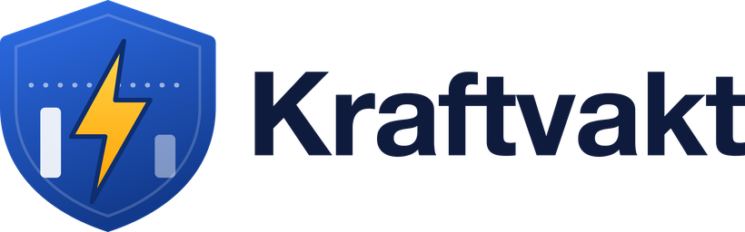

<p align="center">
  <picture>
    <source media="(prefers-color-scheme: dark)" srcset="custom_components/kraftvakt/brand/dark_logo@2x.png">
    
  </picture>
</p>

# Kraftvakt: prioritized power management for Home Assistant

[](https://hacs.xyz/docs/faq/custom_repositories)
[](https://github.com/aalbretsen/kraftvakt/actions/workflows/validate.yml)
[](https://github.com/aalbretsen/kraftvakt/actions/workflows/ci.yml)

Kraftvakt decides which power-hungry appliances may use power, in priority order, for example a water heater, heating cables and EV chargers.
It is made for the Norwegian electricity market and keeps the average consumption over the last hour just below a chosen power limit,
so you avoid a more expensive step in the capacity part of the grid tariff. Everything is set up in a panel in the sidebar. Kraftvakt runs entirely locally, without cloud services.

> **Status:** Currently in beta with preview releases for testing

## Requirements

- Home Assistant 2026.10 or newer
- A sensor from another integration that measures the total power of the house, typically from the HAN port of the electricity meter, with the device class power.
  It may report W or kW. A sensor without a unit is read as W.

## Installation

### HACS (recommended)

1. Open HACS → ⋮ → **Custom repositories**.
2. Add `https://github.com/aalbretsen/kraftvakt` with the type **Integration**.
3. Install **Kraftvakt** and restart Home Assistant.

### Manual

Copy `custom_components/kraftvakt` to `config/custom_components/` in Home Assistant and restart.

## Setup

1. Go to **Settings → Devices & services → Add integration**, search for **Kraftvakt** and finish the setup. It has no settings.
2. Open **Kraftvakt** in the sidebar, or press the cogwheel of the integration, and set the power sensor, the power limit, the appliances and any EV chargers.
3. Press **Save**, go to **Status** and press **Start regulation**.

## How it works

- **Power limit:** the highest allowed average consumption over the last hour, for example 10,000 W: the step of the capacity tariff you want to stay below.
- **Tariff average:** the average consumption over the last hour, sliding. Every clock hour the grid company measures is one of the sliding hours,
  so keeping the tariff average below the power limit keeps every clock hour below it too, and overconsumption is found early in the hour.
- **Regulation average:** the average over a short regulation window, 10 seconds by default. It drives the decisions.
- **Decisions:** at every regulation interval, the regulation turns at most one appliance on or off. Above the power limit, the lowest-priority appliance that is on is turned off.
  When power is free, the next appliance in the priority list is turned on, after a waiting time. Appliances lower in the list give way when one higher up needs the room.
- **Waiting time:** none while plenty of power is free, and close to the power limit up to the waiting time at the power limit, 300 seconds by default.
  An appliance that is turned on again and again waits longer each time.
- **Variants:** an appliance can have variants with another place in the priority list, for example a higher priority in the morning, and their own actions to turn it on or off.
- **Excluded appliance:** the switch **‹appliance› excluded from regulation** takes an appliance out of the regulation.
  It is turned off, and gets no commands until it is included again.
- **Penalty:** a safety valve that should never be needed. If the tariff average still goes above the power limit plus the penalty threshold,
  everything is kept off until the overconsumption is paid back.
- **Safe state:** while the power sensor gives no valid value, everything is kept off. A single missing value is tolerated,
  and a sensor that has not reported for the power sensor timeout has no valid value.
- **Command repeat:** an appliance or EV charger that has had no command for 30 minutes gets the last one again, in case it has changed state by itself.
- **Failed action:** an action that fails, or does not finish within the action timeout, is logged, and the regulation goes on as if it worked.
  The command repeat sends it again later.

Kraftvakt does not know what an appliance uses, and does not read whether it is on. It assumes each appliance is as Kraftvakt last set it.
Do not turn regulated appliances on or off outside Kraftvakt: it can disturb the regulation and trigger a penalty, and the command repeat sets the appliance back.
Exclude the appliance from the regulation instead. EV chargers are the exception: Kraftvakt reads whether a car is connected and whether it charges.

## Starting and stopping

The regulation starts by itself when Home Assistant or the integration starts, provided the configuration is complete:

- a power sensor is chosen,
- every appliance has an entity and actions to turn it on and off, and every variant an expression and the actions it overrides,
- every EV charger has a device, an entity, an action to set the charging current, actions to activate and deactivate unless charging is turned on and off by the current,
  **Car connected**, a charging on/off or a charging power, with **Deactivate on fault** a fault flag,
  and in a group with several at once and dynamic charging order a charging power.

When Home Assistant starts, the regulation waits until Home Assistant has finished starting, so the integrations of the appliances are loaded.
When the configuration is not complete then, it is reported under **Settings → Repairs**.
If the stored configuration (`.storage/kraftvakt.config`) cannot be read, Kraftvakt does not start, the integration shows an error, and the file is left unchanged.

Every start turns all appliances off at once, and deactivates all EV chargers. The regulation then turns them on one by one in priority order,
with the first decision one full regulation interval after the start. The regulation also starts again with everything off when a penalty or the safe state ends.

The **Regulation** switch, and the button on the status page, stop and start the regulation. Stopping turns all appliances off, and nothing is turned on until it starts again.
If the configuration is not complete, turning the switch on gives an error and it stays off. The switch has no stored state, so the regulation runs again after a restart.

## Appliances are not handed back

Kraftvakt never hands an appliance back to you. When an appliance or EV charger is removed from the configuration or excluded from the regulation, when the regulation is stopped,
and when the integration is removed, it stays as Kraftvakt last set it, often off. Set it yourself as you want it: for example, turn the water heater on again, or it stays cold.

## Cloud-controlled devices

Kraftvakt runs locally, but an appliance or EV charger controlled through a cloud service depends on that service and on the internet connection.
A command may be delayed, or lost while the service is down. Kraftvakt logs the failure, goes on as if the command worked, and sends it again with the command repeat,
so an appliance may stay on longer than the regulation wants and the power limit may be exceeded. Prefer devices with local control for appliances that draw a lot of power.
An action that does not finish is stopped by the action timeout, so it does not hold back the commands after it.
The commands that wait for it are merged, so only the newest command for each appliance and EV charger is sent when it finishes.
Mark an EV charger controlled through a cloud service as a **Cloud-controlled EV charger**, see [EV charging](#ev-charging).

An entity of an appliance or EV charger that no longer exists in Home Assistant is reported under **Settings → Repairs**.
An entity that is only unavailable, for example while its cloud service is down, is not.

## EV charging

EV chargers are put in groups, for example one for the chargers in the garage and one for the chargers at the cabin.
A group has its own place in the priority list and its own settings, and Kraftvakt controls only EV chargers that are in a group.
An EV charger is a device in Home Assistant, and every entity Kraftvakt uses for it belongs to that device.
A value from another device, for example whether the car is connected from the car's own integration, is given as a template.

Kraftvakt sets the charging current one ampere at a time, by how much power is free. An EV charger charges only when Kraftvakt has activated it,
so a car that is connected does not start charging by itself. Kraftvakt reads whether a car is connected and whether it is actively charging:

- An EV charger without a car is not activated, and does not stand in the way of the others.
- An EV charger that is activated keeps the minimum current until the car charges. Only a car that charges gets more.
- A car that does not start charging, or pauses for longer than the grace period, is **done**,
  and is not tried again until it is disconnected or the regulation starts again. The status page shows a car that pauses as **Paused**.
- A **done flag**, for example a status sensor of the EV charger with a state for completed, makes the car done at once when it is full.
  While the done flag gives no answer, for example while a cloud service is down, the car is never done.

**Car connected**, the charging on/off, the done flag and the fault flag are each a boolean entity, the states of an entity, or a template.
An unavailable entity or a template that fails counts as false, and for the done flag as no answer.

The settings of the group decide how its cars share the power:

| | Dynamic charging order off | Dynamic charging order on |
|---|---|---|
| **One EV charger at a time** | The first EV charger with a car in the charging priority charges. A car connected higher up takes over. | An EV charger that charges goes on until it is done. The others wait as **Queued**. |
| **Several at once** | The EV chargers share the power, one ampere each in turn in the charging priority. A car connected higher up gets room first. | The EV chargers that charge share the power. A car connected later waits as **Queued** until its power reserve is free, if need be after the others are set to their minimum current. |

With dynamic charging order, an EV charger that stops charging, for whatever reason, goes to the back of the queue.
One whose car is disconnected is deactivated, so a car connected again waits for its turn.

- **Charging window:** the EV charger charges only within this time each day, in the time zone of Home Assistant. It may span midnight.
  With **Finish charging after the charging window**, a car that is charging when the charging window ends may go on until it stops.
- The switch **‹charger› override charging window** lets the EV charger charge outside the charging window.
  It turns itself off as chosen in **End the override**: when you turn it off, when the car no longer charges, or when the car is disconnected.
  The last two wait for the car, so the switch can be turned on before the car arrives.
  The override only allows charging: it does not move the EV charger ahead of the others in its group.
- **Cloud-controlled EV charger:** for an EV charger controlled over the internet. It gets no repeated commands while no car is connected,
  and the car gets the **Start delay** to start charging, while its power reserve is kept free. The status page shows it as **Starting** meanwhile.
- **Deactivate on fault:** while a **fault flag** shows a fault, the EV charger is deactivated, and the others in its group may charge.
  The status page shows it as **Fault**. An unavailable entity is no fault, so a cloud service that is down does not stop the charging.
- An EV charger that cannot turn charging on and off, only take a current, is set to turn charging on and off by **the charging current**:
  it is started with its minimum current and stopped with 0 A.
- To keep an EV charger from charging for a while, turn on its switch **‹charger› excluded from regulation**.

The helper texts in the panel tell what each setting does.

## The panel

The panel has a menu at the top with the status page and four configuration pages. Only administrators have access.

Changes are collected in a draft. **Save** stores everything at once, and **Discard** goes back to what is stored. Errors are shown at the field,
and nothing is saved until they are fixed. The panel asks before unsaved changes are discarded. The configuration can only be changed while the regulation is stopped;
while it runs, the configuration pages are locked. A saved configuration is used the next time the regulation starts.

### Configuration pages

- **General:** power sensor, power limit, turn-on margin, regulation window, regulation interval, waiting time at the power limit and penalty threshold.
  The helper text under each field tells what the setting does, with its valid range and default.
- **Appliances:** the priority list, with the most important appliance at the top; drag to change the order. An appliance has an entity, an optional power reserve,
  actions to turn it on and off, and its variants. A variant is a separate entry in the priority list with an expression, a boolean entity or a template,
  and can have its own action to turn on, to turn off or both. The variants are evaluated in the order of the appliance's list, and the top true expression applies.
  The power reserve applies to every variant. Each group of EV chargers is in the list under its name, and is moved like an appliance.
- **EV charging:** one card per group of EV chargers, with the name, one EV charger at a time, dynamic charging order, and the EV chargers in charging priority.
  Drag an EV charger to another group to move it there. An EV charger starts with its device in Home Assistant.
  When Kraftvakt has a charger profile for the device, choosing it fills in the fields from the profile, so check what was filled in.
  A profile uses only enabled entities: enable the ones it needs that the integration disables by default before choosing the device.
  Without a profile, the fields are filled in by hand.
  Then come the entity and the power reserve, whether charging is turned on and off by actions or by the charging current,
  followed by the actions, the charging current, car connected, actively charging, the done flag, cloud control, the charging window and deactivate on fault.
- **Advanced:** the waiting time curve, the waiting time on repeated turn-on, the command repeat interval, and the timeouts for actions and for the power sensor.
  The tables show the actual waiting time, rounded up to the regulation interval, since an appliance is turned on at the first decision after its waiting time.

**Restore defaults**, under the last card on General and Advanced, puts the settings on the page back to their defaults, except the power sensor and the power limit.
Like any other change, it is not stored until you press **Save**.

### Actions

Actions adapt to the domain of the entity. A standard action is offered when the domain has one, and some device types have actions of their own,
such as the HVAC mode and temperature of a thermostat. A thermostat starts with the action that sets its HVAC mode,
heat to turn it on and off to turn it off, since most thermostats are better controlled that way than turned on and off.
Every action can also be a custom action, made with the action editor of Home Assistant,
see [Template and action examples](#template-and-action-examples). An entity used by another appliance or EV charger cannot be chosen.

### Status page

The status page shows whether the regulation runs, with the button to start and stop it. If the configuration is not complete, it lists what is missing,
with a link to the page where it is fixed. While the regulation runs, it shows the consumption now and the averages against the power limit, the next decision,
the safe state and the penalty when they occur, and the priority list as it stands: each appliance at the place of its current variant,
and each group with its EV chargers in the current charging priority and their charging current. Each row has a label telling how it stands; hover over it for the explanation.
A dashed line goes under the last entry that is on, with the free power, and a bar shows the time left until the next appliance, or one more ampere, is turned on.
Press the consumption now, an average or the power limit to open its entity in Home Assistant, with its history.
Press an appliance or an EV charger to open its entity: for an EV charger, the entity Kraftvakt activates.
Press the name of the device in that dialog to get to the device.

## Entities

All entities belong to the service device **Kraftvakt**.

| Entity | Description |
|---|---|
| **Regulation** | |
| `switch.kraftvakt_regulation` (Regulation) | On while the regulation runs. Turn off to stop the regulation, and on to start it again. |
| `binary_sensor.kraftvakt_regulation_safe_state` (Regulation safe state) | On while the regulation is in safe state. Can trigger an automation that notifies you. |
| `sensor.kraftvakt_regulation_steps_on` (Regulation steps on) | Diagnostic. The number of steps that are on: each appliance is one step, and each ampere of an EV charger, from the minimum current up, is one step. |
| **Power** | |
| `number.kraftvakt_power_limit` (Power limit) | The power limit in W, the same as in the panel. Can also be set while the regulation runs. |
| `sensor.kraftvakt_power_regulation_average` (Power regulation average) | The regulation average in W. |
| `sensor.kraftvakt_power_tariff_average` (Power tariff average) | The tariff average in W. |
| `sensor.kraftvakt_power_free` (Power free) | Diagnostic. The power limit minus the regulation average, in W. Negative above the power limit. |
| **Waiting time** | |
| `sensor.kraftvakt_waiting_time_remaining` (Waiting time remaining) | Diagnostic. Seconds until the decision where the waiting appliance or ampere is turned on, 0 when nothing waits. |
| `sensor.kraftvakt_waiting_time_next_turn_on` (Waiting time next turn-on (calculated)) | Diagnostic. The waiting time in seconds the next turn-on gets from the last regulation average and the waiting time curve, without the growth on repeated turn-on or a power reserve kept free for an EV charger that starts. |
| **Penalty** | |
| `binary_sensor.kraftvakt_penalty_active` (Penalty active) | Diagnostic. On during a penalty period. |
| `sensor.kraftvakt_penalty_overconsumption` (Penalty overconsumption) | Diagnostic. The overconsumption in Wh at the last decision: the net energy above the power limit since the tariff average went above it. 0 when there is none. |
| **Appliance** | |
| `switch.kraftvakt_appliance_<appliance>_excluded` (‹appliance› excluded from regulation) | One per appliance. Turn on to take the appliance out of the regulation, so it is never turned on and gets no repeated commands. |
| **EV charger** | |
| `switch.kraftvakt_charger_<charger>_excluded` (‹charger› excluded from regulation) | One per EV charger. Turn on to take the EV charger out of the regulation, so the car never charges and the EV charger gets no repeated commands. |
| `switch.kraftvakt_charger_<charger>_window_override` (‹charger› override charging window) | One per EV charger. Turn on to let the EV charger charge outside the charging window. Turns itself off as chosen in **End the override**. |
| `switch.kraftvakt_charger_<charger>_finish_after_window` (‹charger› finish charging after charging window) | One per EV charger. The same setting as **Finish charging after the charging window** in the panel. Can be changed while the regulation runs. |
| `binary_sensor.kraftvakt_charger_<charger>_allowed_to_charge` (‹charger› allowed to charge) | Diagnostic. One per EV charger. On while the EV charger may charge: it is not excluded, no fault flag showed a fault at the last decision, and it has no charging window, is inside it, has **‹charger› override charging window** on, or is finishing the charging after the charging window. It follows the clock, also while the regulation is stopped, and stays on without a break when the charging window ends with an EV charger that goes on finishing. |

The sensors are updated every time a regulation window closes. The sensors that depend on the averages are unavailable until the first regulation window has closed,
and after two regulation windows in a row closed without a valid value from the power sensor, also while the regulation is stopped.
When the power sensor gives a valid value again, the measurements from before are kept, and the time without a valid value is counted with the last valid value before it.

When Kraftvakt starts, the hour before is read from the history of the power sensor in the Home Assistant recorder, so the tariff average is right also just after a restart.
The time Home Assistant was down is counted with the last value before it stopped. Without history, the first measurement is used back in time.

When Home Assistant has been paused, for example on a host that sleeps or in a virtual machine that is paused, the regulation windows it missed are skipped,
with a warning in the log. The regulation goes on at the next regulation window, by the clock as it is then, and the pause is counted with the last valid value.
The status page and the sensors are updated at once.

A new value in **Power limit** is stored at once and used from the next decision, also while the regulation runs, without starting it again.
Above a lower limit, appliances are turned off one at each decision as usual.

The appliance and EV charger switches can be used while the regulation runs and apply from the next decision, without restarting it.
An excluded appliance or EV charger gets no repeated commands from the next regulation window. Their state is stored at once and kept over a restart.
The entities of an EV charger do not depend on its group, and are kept when it is moved to another group.

The entity IDs are the same in every language and are grouped by what they concern: `regulation`, `power`, `waiting_time`, `penalty`, `appliance` and `charger`.
The names shown follow the language of Home Assistant. ‹appliance› is the name of the entity of the appliance. ‹charger› is the name of the device of the EV charger.
The entity ID keeps the name from when the appliance or EV charger was added.

**Waiting time next turn-on (calculated)** is disabled by default; enable it under the entity's settings when you want it.

## Diagnostics

**Download diagnostics** on the integration's page gives the configuration, the status, everything Kraftvakt holds in memory, the last decisions and failed actions,
and the device of each EV charger with its entities and their values, for a bug report.
What it holds in memory includes the measurements of the power sensor over the last hour.

## Template and action examples

Templates use the template language of Home Assistant (Jinja2), and actions are the same as in automations and scripts.
In the action editor you can switch to YAML from the ⋮ menu and paste the examples.
Every template and action gets the variables `entity_id` (the entity of the appliance or EV charger) and `entity` (its state object,
for example `entity.state` and `entity.attributes`), so the templates keep working when the entity is replaced.
The action for the charging current also gets `current`, `min_current` and `max_current`. `current` is always between the minimum and maximum charging current,
except 0 for an EV charger whose charging is turned on and off by the charging current.

A template is true only when it gives the boolean value true. Anything else, including an error in the template, counts as false. An entity is true only when it is `on`.

**Variant «Morning»** that gives the water heater a higher priority between 05 and 08:

```jinja
{{ 5 <= now().hour < 8 }}
```

**Variant «Cold»** for a heat pump when it is below 18 degrees indoors:

```jinja
{{ entity.attributes.current_temperature | float(99) < 18 }}
```

**Car connected** from the status sensor of the charger, the same as the states of the entity with `disconnected` as the state for disconnected:

```jinja
{{ states('sensor.garage_charger_status') in ['connected', 'charging', 'awaiting_start'] }}
```

**Charging power** from a sensor in kW whose unit is not set, in W:

```jinja
{{ states('sensor.garage_charger_power_kw') | float * 1000 }}
```

**Charging on/off** from a sensor with the charging current the charger reports:

```jinja
{{ states('sensor.garage_charger_current') | float(0) > 1 }}
```

When the sensor is unavailable, `float(0)` gives 0 and the template gives false, so the EV charger counts as not charging,
and as stopped for **End the override**. Leave out the default, `| float`, to let an unavailable sensor give no value instead:
the EV charger still counts as not charging, but the override does not end.

**Done flag** from the status sensor of the charger, with no answer while the charger is offline:

```jinja
{{ none if status in ['offline', 'unknown', 'unavailable'] else status == 'completed' }}
```

**Fault flag** from the status sensor of the charger:

```jinja
{{ is_state('sensor.garage_charger_status', 'error') }}
```

**Turn on** an appliance by setting a temperature instead of turning it on:

```yaml
- action: climate.set_temperature
  target:
    entity_id: "{{ entity_id }}"
  data:
    temperature: 22
```

**Turn off** the same appliance by setting it to frost protection:

```yaml
- action: climate.set_temperature
  target:
    entity_id: "{{ entity_id }}"
  data:
    temperature: 8
```

**Set charging current** with a service from the charger's integration that takes the current per phase.
`my_charger.set_current` is an example; use the service and fields of your charger's integration:

```yaml
- action: my_charger.set_current
  data:
    charger_id: garage
    phase1: "{{ current }}"
    phase2: "{{ current }}"
    phase3: "{{ current }}"
```

## Development

Requires Python in the version in `pyproject.toml`, the same as the Home Assistant version in `requirements_dev.txt` requires, and [uv](https://docs.astral.sh/uv/).
The development dependencies are in `requirements_dev.txt`. Make the virtual environment once:

```bash
uv venv --python 3.14
nvm use
```

Build all with Node active, see [Panel](#panel):

```bash
uv run scripts/build.py
```

The script installs the development dependencies of the integration and the panel, runs the tests with the coverage required, ruff and mypy,
and type checks, tests and builds the panel. It stops at the first step that fails, and tells when the panel bundle has changed and must be committed.
Every commit passes it.

The code is in `custom_components/kraftvakt/`. The regulation is plain Python without Home Assistant in `regulation/`, and `runtime.py` connects it to Home Assistant.
The charger profiles are in `charger_profiles/`, one module per profile in `charger_profiles/profiles/`.
The tests are in `tests/`, with unit tests in `tests/unit/`, and the panel's tests in `frontend/test/`. The simulator is in `simulator/`, see [SIMULATOR.md](SIMULATOR.md).
The tools that read a file from **Download diagnostics**, for example to draft a charger profile from it, are in `diagnostics/`, see [DIAGNOSTICS.md](DIAGNOSTICS.md).

### Panel

The panel is written in Lit and TypeScript in `frontend/` and built with Node.js, in the version in `.nvmrc`, the same as the Home Assistant frontend uses.
Install and activate it with [nvm](https://github.com/nvm-sh/nvm) or [nvm.fish](https://github.com/jorgebucaran/nvm.fish):

```bash
nvm install
```

```bash
nvm use
```

The built bundle, `custom_components/kraftvakt/frontend/kraftvakt-panel.js`, is committed, because HACS installs straight from the repository.
Build it again after every change in `frontend/`, and commit the source and the bundle together. CI fails if the committed bundle does not match the source.
`scripts/build.py` builds it with everything else; to work on the panel alone:

```bash
cd frontend
npm ci
npm run typecheck
npm test
npm run build
```

`npm run watch` builds again on every change. The bundle is loaded with the version from `manifest.json` in the URL, so the browser may use an old bundle after a new build.
Reload the page without cache then. The texts of the panel are in `frontend/src/translations/` (English and Norwegian) and follow the language of the user in Home Assistant.

### Dependencies

Every dependency is pinned, and most follow Home Assistant: `pytest-homeassistant-custom-component` decides the version of Home Assistant and pytest,
Home Assistant decides the frontend, ruff, mypy and Python, and the Home Assistant frontend decides Node, Lit, TypeScript and `@mdi/js`.
The other build tools of the panel and the GitHub actions get their newest release. Update them all with Node active:

```bash
uv run scripts/update_dependencies.py
```

The script asks before it changes the Python used for development or Node, and updates the rest without asking.
Python is offered in the newest version Home Assistant supports; accepting it changes the version in every file that names it and makes `.venv` again.
Node is offered in the version the Home Assistant frontend uses, and the script tells when a newer Node LTS release exists.
At the end, the script prints what changed, and asks whether to build all with `scripts/build.py`.
When Node has changed, the build stops: activate the new Node, and build again:

```bash
nvm install
```

```bash
uv run scripts/build.py
```

### Releasing

Versions follow [SemVer](https://semver.org/). A release is made from an up-to-date `main` with a clean working tree and Node active:

```bash
uv run scripts/release.py 0.2.0
```

The script builds all with `scripts/build.py`, sets the version in `manifest.json`, `pyproject.toml` and the panel's `package.json` and lock file, commits, tags `v0.2.0`,
and asks before it pushes `main` and the tag. The tag starts the release workflow, which checks the versions and creates a draft release on GitHub.
Write the release notes there and publish it; HACS offers only published releases.
A version with a pre-release part, like `0.2.0-beta.1`, becomes a GitHub pre-release, which HACS offers only to users who turn on pre-releases for Kraftvakt.

### Local Home Assistant

Run a local Home Assistant against the repository. `config/custom_components/` is a plain folder with one link to Kraftvakt and one to the simulator:

```bash
mkdir -p config/custom_components
ln -s ../../custom_components/kraftvakt config/custom_components/kraftvakt
ln -s ../../simulator/custom_components/kraftvakt_simulator config/custom_components/kraftvakt_simulator
uv run hass -c config
```

The simulator, for testing without a HAN port and real appliances, is described in [SIMULATOR.md](SIMULATOR.md).

From the same machine you log in without a password at http://127.0.0.1:8123 (`trusted_networks` for `127.0.0.1` and `::1` in `config/configuration.yaml`).
Other machines require a password.

### WebSocket API

The panel talks to the integration over its own WebSocket commands. All of them require an administrator.

| Command | Does |
|---|---|
| `kraftvakt/capabilities` | Gives the standard actions per field, the limits and the defaults. |
| `kraftvakt/charger_profile/get` | Gives the charger profile of a device, if Kraftvakt has one, and the fields of an EV charger it fills. |
| `kraftvakt/config/get` | Gives the configuration, the names of the entities and what is missing. |
| `kraftvakt/config/save` | Stores the whole configuration. Refused while the regulation runs. An invalid configuration is not stored, and the response gives the errors per field. |
| `kraftvakt/regulation/set_running` | Starts or stops the regulation, as the **Regulation** switch. |
| `kraftvakt/status/subscribe` | Sends the status at once and then for every regulation window, every decision, and on start, stop and save, and when missed regulation windows are skipped. |

### Logo and icon

The sources are in `assets/brand/`. The PNG files in `custom_components/kraftvakt/brand/` (loaded directly by Home Assistant from 2026.3) are built with:

```bash
uv run --with cairosvg --with pillow scripts/build_brand.py
```

## License

[MIT](LICENSE)
